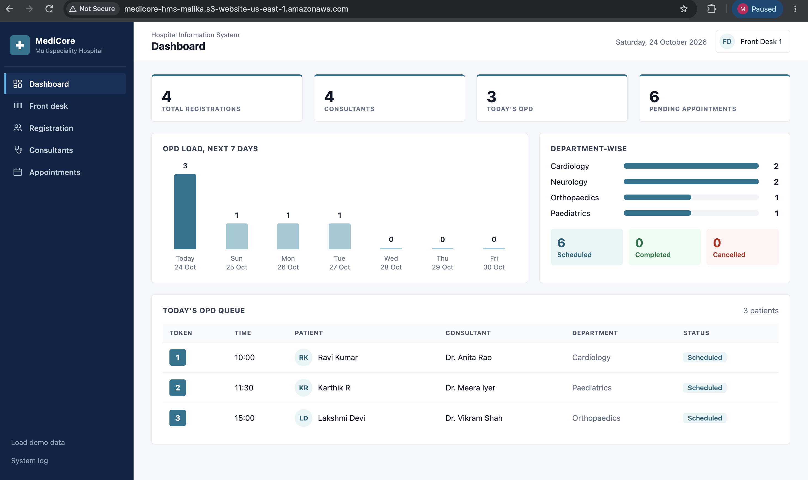
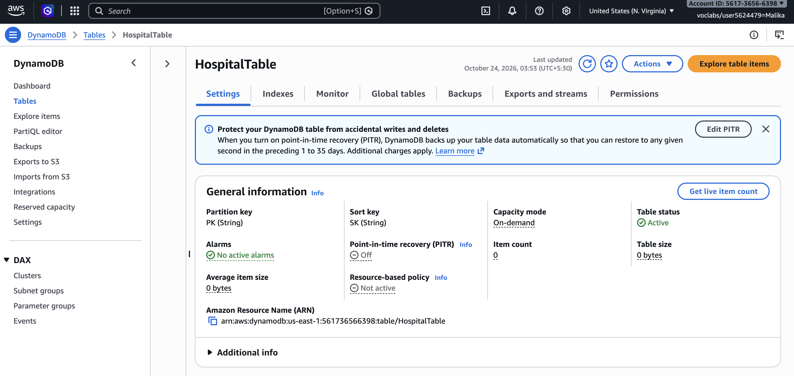
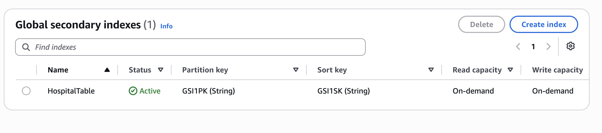
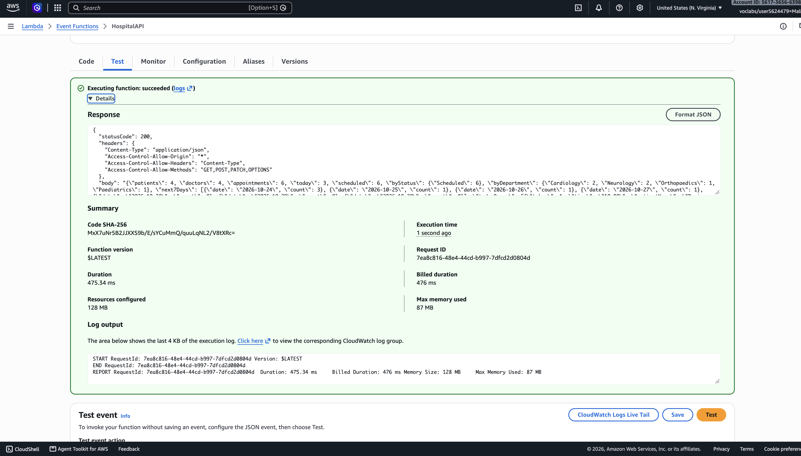
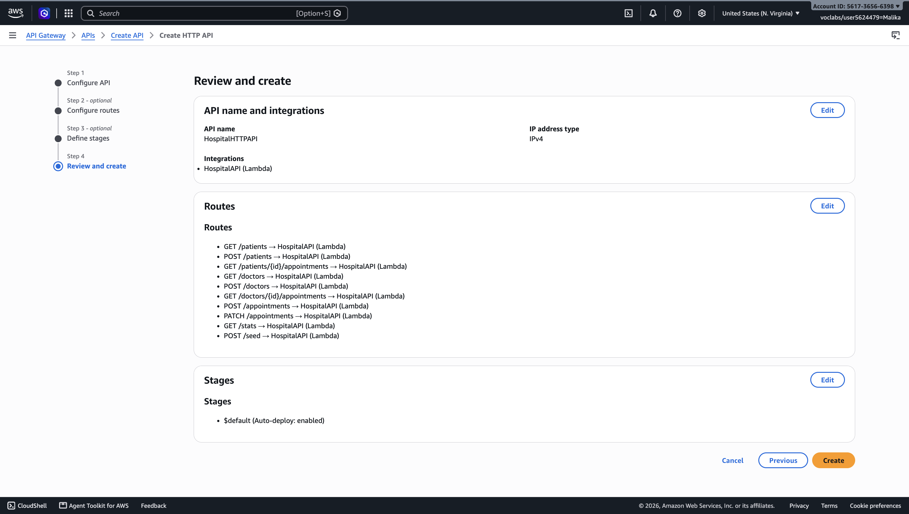
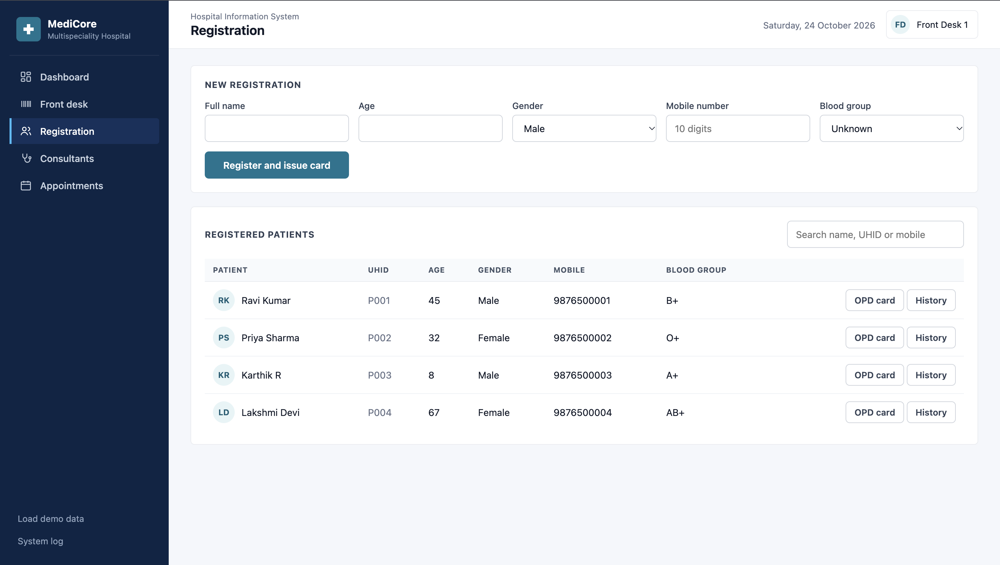
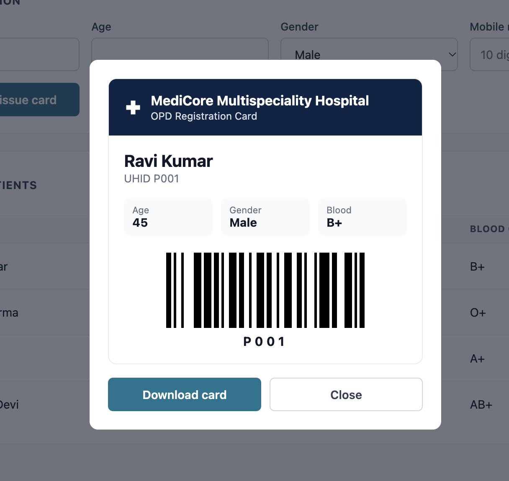
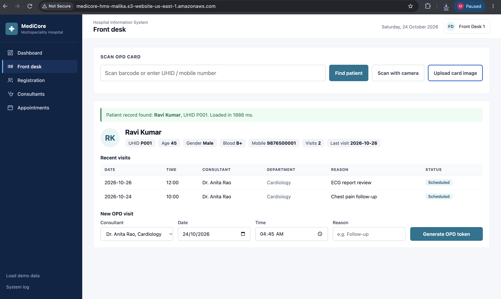
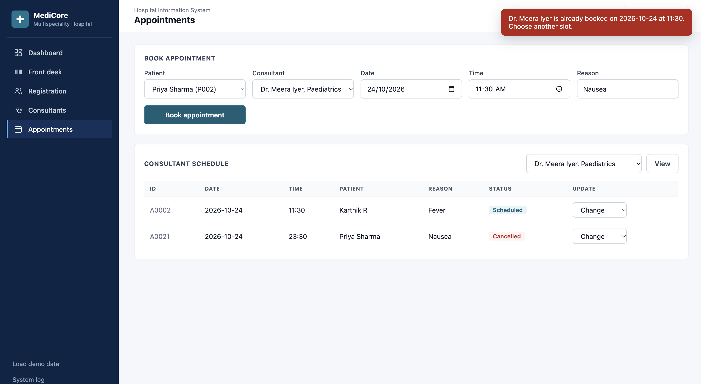

# MediCore: Serverless Hospital Management System on Amazon DynamoDB

A cloud-native hospital management web app built on AWS. It manages patients, doctors and appointments using a single-table Amazon DynamoDB design, a Python AWS Lambda backend, an Amazon API Gateway HTTP API, and a static web frontend hosted on Amazon S3.

## Live links

- **Web app:** http://medicore-hms-malika.s3-website-us-east-1.amazonaws.com
- **API:** https://vpdhfevax4.execute-api.us-east-1.amazonaws.com (try `/stats`)

Deployed in an AWS Academy Learner Lab (region us-east-1). The links work while the lab resources are active.



## Key features

| Feature | How it works on AWS |
|---|---|
| **Digital OPD card and front-desk check-in** | Every patient gets a UHID and a digital OPD card with a Code 128 barcode, downloadable as an image to keep on their phone. At reception the barcode is scanned by camera, from an uploaded image, or by a handheld barcode scanner; the patient can also be found by mobile number. Their record, visit history and a pre-filled booking form appear at once. The barcode holds only the patient ID; details are fetched live from DynamoDB, so no personal data is encoded in it. |
| **Double-booking prevention** | Booking writes a slot-lock item (`DOCTOR#id` / `SLOT#date,time`) and the appointment in one `TransactWriteItems` call. The lock has the condition `attribute_not_exists(PK)`, so if the slot is taken the whole transaction is rejected and the API returns 409 Conflict. |
| **Cancel frees the slot** | Cancelling updates the status and deletes the slot lock in the same transaction; restoring a cancelled visit re-acquires the lock only if nobody else took it. |
| **Sequential IDs** | P001, D001, A0001 come from atomic counters (`UpdateItem ADD`), with a conditional put so an ID is never reused or overwritten. |
| **Analytics dashboard** | Next-7-days load, appointments by department, status breakdown and today's OPD queue with token numbers, all computed from DynamoDB Queries. |
| **AWS activity log** | A panel in the app shows every API call, the DynamoDB operation behind it, HTTP status and round-trip latency. |
| **Validation** | 10-digit phone numbers, age 0 to 120, no bookings in the past (Indian Standard Time), unknown patients or doctors rejected. |
| **Patient search** | Instant filter by name, ID or phone. |

## Architecture

```
Browser (index.html on Amazon S3 static website hosting)
        |  HTTPS fetch
Amazon API Gateway (HTTP API, 10 routes, CORS enabled)
        |
AWS Lambda (Python 3.12, lambda_function.py, LabRole)
        |  boto3
Amazon DynamoDB (HospitalTable, on-demand, GSI1)
        |
Amazon CloudWatch (logs and metrics)
```

## DynamoDB data model (single-table design)

| Entity | PK | SK | GSI1PK | GSI1SK |
|---|---|---|---|---|
| Patient | `PATIENT#P001` | `PROFILE` | `TYPE#PATIENT` | `<name>` |
| Doctor | `DOCTOR#D001` | `PROFILE` | `TYPE#DOCTOR` | `<department>#<name>` |
| Appointment | `PATIENT#P001` | `APPT#2026-10-25T10:00#A0001` | `DOCTOR#D001` | `APPT#2026-10-25T10:00` |
| Slot lock | `DOCTOR#D001` | `SLOT#2026-10-25T10:00` | | |
| Counter | `COUNTER` | `PATIENT` / `DOCTOR` / `APPOINTMENT` | | |

## Access patterns

| # | Access pattern | How it is served |
|---|---|---|
| 1 | List all patients | Query GSI1 where GSI1PK = `TYPE#PATIENT` |
| 2 | List all doctors, sorted by department | Query GSI1 where GSI1PK = `TYPE#DOCTOR` |
| 3 | Appointment history of a patient | Query table where PK = `PATIENT#id` and SK begins with `APPT#` |
| 4 | Doctor's schedule, sorted by date and time | Query GSI1 where GSI1PK = `DOCTOR#id` and GSI1SK begins with `APPT#` |
| 5 | Book an appointment without double booking | GetItem on patient and doctor, then TransactWriteItems (slot lock + appointment) |
| 6 | Update or cancel an appointment | TransactWriteItems (status update + free or re-take the slot lock) |

No table scans are used anywhere.

## API

| Method | Route | Purpose |
|---|---|---|
| GET | /patients | List patients |
| POST | /patients | Register a patient |
| GET | /patients/{id}/appointments | Patient history |
| GET | /doctors | List doctors |
| POST | /doctors | Add a doctor |
| GET | /doctors/{id}/appointments | Doctor schedule |
| POST | /appointments | Book an appointment |
| PATCH | /appointments | Update status (Scheduled, Completed, Cancelled) |
| GET | /stats | Dashboard counts |
| POST | /seed | Load sample data |

## Files

| File | Purpose |
|---|---|
| `lambda_function.py` | Lambda backend, all routes and DynamoDB access |
| `index.html` | Single-page web frontend (calls the API above) |
| `screenshots/` | AWS console and app screenshots |

## How to deploy

1. **DynamoDB:** create `HospitalTable` with partition key `PK` (String), sort key `SK` (String), on-demand capacity, and a global secondary index `GSI1` on `GSI1PK` / `GSI1SK` (projection All).
2. **Lambda:** create `HospitalAPI` (Python 3.12) with the LabRole execution role, paste `lambda_function.py`, set the timeout to 15 seconds.
3. **API Gateway:** create an HTTP API with the 10 routes above integrated with `HospitalAPI`, stage `$default`, CORS allowing `*`, methods GET, POST, PATCH, OPTIONS and header `content-type`.
4. **Frontend:** set `API_URL` in `index.html` to the API invoke URL.
5. **S3:** create a bucket, upload `index.html`, enable static website hosting, and add a public-read bucket policy.

## Screenshots

| | |
|---|---|
|  |  |
| DynamoDB HospitalTable, on-demand | Global secondary index GSI1 |
|  |  |
| Lambda test, status 200 | API Gateway HTTP API, 10 routes |
|  |  |
| Patient registration | OPD card with UHID barcode |
|  |  |
| Front desk check-in | Double booking blocked |

All 20 screenshots are in the `screenshots/` folder.

## AWS services used

Amazon DynamoDB, AWS Lambda, Amazon API Gateway, Amazon S3, AWS IAM, Amazon CloudWatch.

## Student details

- **Name:** Malika Balaji
- **Programme:** B.Tech Computer Science and Engineering (AI and ML), Vellore Institute of Technology, Vellore
- **Register number:** 24BAI0114
- **Course:** Cloud Architecture Design
- **Faculty:** Prof. Saranya P
- **GitHub:** https://github.com/malikabalaji
